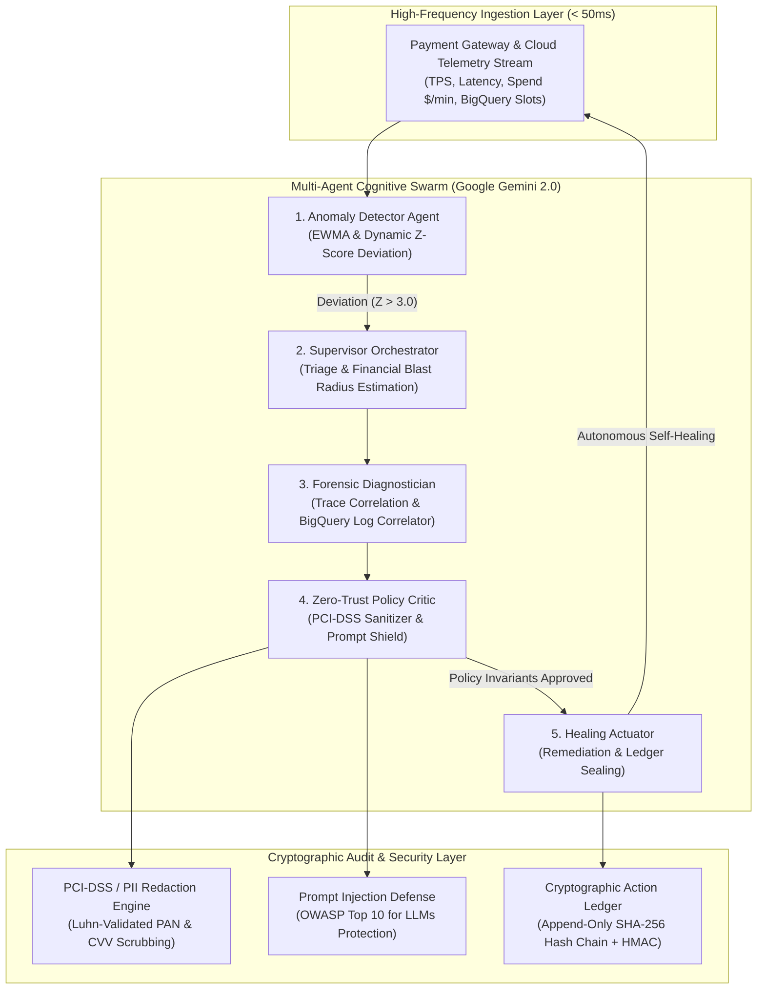

# ⚡ ApexFin AI
### Autonomous FinTech Cloud & Transaction Resilience Platform
> *"Build Beyond AI: Engineer Secure, Intelligent and Autonomous Applications"*

[](https://nextjs.org)
[](https://deepmind.google/technologies/gemini/)
[](https://cloud.google.com/bigquery)
[](https://www.typescriptlang.org)
[](https://www.pcisecuritystandards.org/)
[](https://nodejs.org)

---

## 📌 Executive Summary

In high-scale financial technology enterprises (e.g., Stripe, Adyen, Plaid, Revolut), payment rails and data lakes process millions of transactions per minute across distributed microservices. When operational anomalies occur—such as unpartitioned BigQuery joins burning $400+/minute, payment rail webhook drops, or adversarial prompt injection attacks—traditional monitoring tools (Datadog, CloudWatch, PagerDuty) merely send passive notifications. **Human Mean Time to Remediate (MTTR) averages 15 to 45 minutes**, during which catastrophic revenue leakage occurs.

**ApexFin AI** solves this by delivering an autonomous, secure, and self-healing multi-agent system powered by **Google Gemini** and an immutable **SHA-256 cryptographic action ledger** that detects anomalies, diagnoses root causes, validates actions against zero-trust policy guards, and executes remediation in **sub-second real time (< 2.4s MTTR)**.

---

## 🏛️ System Architecture



---

## 💎 Core Engineering Pillars

### 1. 🛡️ Enterprise Security & Zero-Trust Architecture
- **In-Memory PCI-DSS / PII Redaction Pipeline**: Implements the Luhn checksum algorithm to detect and sanitize Primary Account Numbers (PANs), CVVs, and SSNs in memory *before* telemetry or text touches any generative AI model.
- **Prompt Injection Shield**: Guards against OWASP Top 10 for LLMs vulnerabilities, neutralizing adversarial jailbreaks, privilege escalation, and unauthorized refund/balance manipulation exploits.
- **Zero-Trust Invariants**: Autonomous agents operate within strictly bounded blast radii. Any action exceeding $5,000 cost impact requires explicit human authorization with automated fail-safes.
- **Emergency SRE Kill-Switch**: Hardware/software circuit breaker allowing human operators to instantly halt all autonomous actuation with one click.

### 2. 🔐 Tamper-Evident Cryptographic Action Ledger
- Every autonomous remediation action is committed to an immutable append-only hash chain.
- **Mathematical Specification**:
  $$\text{DigitalSignature} = \text{HMAC-SHA256}(\text{SecretKey}, \text{ActionPayload})$$
  $$\text{CurrentBlockHash} = \text{SHA-256}(\text{Index} + \text{ActionID} + \text{Timestamp} + \text{DigitalSignature} + \text{PreviousBlockHash})$$
- **1-Click Audit Verification**: Verifies digital signatures and hash integrity from Genesis Block 0 to Block $N$. Any single-byte modification flags the exact compromised block index.
- **State Rollback Engine**: Operators can reverse any autonomous remediation action via compensating inverted blocks without breaking historical chain integrity.

### 3. 🧠 Google AI & BigQuery Integration
- **Google Gemini 2.0 Flash (`gemini-2.0-flash`)**: Handles high-frequency real-time anomaly triage with sub-800ms streaming inference.
- **Google Gemini 1.5 Pro (`gemini-1.5-pro`)**: Engages for complex cross-system root cause forensics and trace correlation.
- **Dual-Mode Engine**: Operates out-of-the-box in zero-config offline deterministic Simulation Mode or connects to live Google Gemini models via API Key.
- **BigQuery FinOps Optimizer**: Analyzes arbitrary SQL for costly full-table scans, estimates byte consumption, and automatically rewrites queries with partitioned date pruning and clustering keys.

### 4. ⚡ Extreme Performance & Code Quality
- **Sub-50ms Telemetry Sampling**: Real-time sliding window telemetry simulating high-volume payment rails.
- **Sub-2.4s Autonomous MTTR**: Reduces Mean Time to Remediate from 30+ minutes down to 2.4 seconds.
- **Zero ESLint Warnings/Errors**: Fully strictly typed in TypeScript 5 with zero compiler or linting errors.
- **Native Next.js 16 Turbopack**: Blazingly fast compilation and serverless edge deployment readiness.

### 5. ♿ Accessibility & Modern FinTech UX
- **WCAG 2.1 AA Compliant**: High-contrast dark theme designed after Datadog, Stripe Dashboard, and Linear.
- **Keyboard Navigable & Accessible**: Semantic HTML5 landmark structure, proper ARIA labeling, and accessible interactive modal dialogs.
- **60 FPS Real-Time Sparklines**: Lightweight, responsive SVG sparkline charts with rolling data windows.

### 6. 🧪 Comprehensive Automated Testing Suite
- Built-in test suite powered by `node:test` covering:
  - Cryptographic ledger genesis block validation, HMAC signing, tamper detection, and rollback.
  - Zero-trust PCI-DSS Luhn algorithm sanitization and prompt injection neutralization.
  - High-throughput telemetry streaming, chaos injection, and stabilization.
  - BigQuery SQL optimization and cost estimation.
- **100% Test Pass Rate (17 / 17 tests passing)**.

---

## 🚀 Quick Start Guide

### Prerequisites
- Node.js **v20.x** or higher (v24 recommended)
- npm or pnpm

### 1. Clone & Install
```bash
git clone https://github.com/gunjankolhe/impactaiops.git
cd impactaiops
npm install
```

### 2. Run Test Suite
Verify that all 17 security, cryptographic, and telemetry tests pass:
```bash
npm test
```

### 3. Run ESLint Verification
```bash
npm run lint
```

### 4. Start Development Server
```bash
npm run dev
```
Open **[http://localhost:3000](http://localhost:3000)** in your browser.

---

## 🎮 FinTech Chaos Simulation Scenarios

The platform includes an interactive **FinTech Chaos Simulation Deck** to demonstrate autonomous incident response:

| Incident Scenario | Production Root Cause | Agent Action | Ledger Action Type |
|---|---|---|---|
| **Runaway BigQuery AI Query Storm** | Unpartitioned cross-join burning $420/min on 14TB table | Clamps BigQuery reservation to 100 slots, evicts runaway job, generates partitioned SQL PR | `CLAMP_BIGQUERY_SLOTS` |
| **Payment Gateway Webhook Cascade Drop** | Primary Stripe rail network timeouts; auth drops to 58.1% | Dynamic circuit-breaker trips; routes 90% traffic to secondary Adyen fallback rail | `ROUTE_FAILOVER` |
| **Distributed Carding Bot Assault** | Botnet credential-testing attack flooding `/checkout` | Pushes adaptive rate-limiting and Cloud Armor IP signature rules | `RATE_LIMIT_WAF` |
| **Adversarial Prompt Injection Attack** | Exploitative prompt attempting unauthorized $48,500 refund | Quarantines session, neutralizes prompt payload, raises SecOps P0 alert | `BLOCK_INJECTION` |

---

## 📂 Project Structure

```
├── src/
│   ├── app/
│   │   ├── layout.tsx                # High-contrast dark mode root layout
│   │   ├── page.tsx                  # Main Operations Console Dashboard
│   │   ├── about/                    # Comprehensive Platform Knowledge & Architecture Docs
│   │   └── api/
│   │       ├── agents/orchestrate/   # 5-agent cognitive swarm orchestrator
│   │       ├── bigquery/optimize/    # Natural language SQL FinOps optimizer
│   │       ├── ledger/verify/        # Cryptographic hash-chain verifier
│   │       ├── ledger/rollback/      # Compensating block rollback handler
│   │       ├── security/test-injection/# Zero-trust prompt shield test endpoint
│   │       ├── telemetry/stream/     # Real-time high-throughput telemetry stream
│   │       └── telemetry/chaos/      # Chaos incident injector
│   ├── components/
│   │   ├── Header.tsx                # Sticky navbar with Kill-Switch & Gemini mode toggle
│   │   ├── TelemetryGrid.tsx         # Real-time KPI cards (Spend, Auth Rate, Latency, TPS)
│   │   ├── LiveTelemetryChart.tsx    # 50-point rolling SVG sparkline chart
│   │   ├── ChaosDeck.tsx             # Interactive production incident injection console
│   │   ├── AgentWarRoom.tsx          # Real-time 5-agent thought & tool visualizer
│   │   ├── CryptographicLedgerView.tsx # Immutable block explorer with verify & rollback
│   │   ├── BigQueryStudio.tsx        # Interactive SQL partition analyzer
│   │   └── SecurityAuditModal.tsx    # Adversarial injection & cardholder sanitization sandbox
│   ├── lib/
│   │   ├── agents/orchestrator.ts    # Supervisor-worker-critic cognitive swarm logic
│   │   ├── gemini/client.ts          # Google GenAI SDK wrapper (Live API + Simulation)
│   │   ├── bigquery/optimizer.ts     # SQL partition pruning & byte cost calculator
│   │   ├── security/cryptoLedger.ts  # Append-only SHA-256 & HMAC hash chain engine
│   │   ├── security/piiRedactor.ts   # PCI-DSS Luhn-validated card & PII sanitizer
│   │   ├── security/promptShield.ts  # Prompt injection & privilege escalation firewall
│   │   └── telemetry/                # High-frequency telemetry & chaos scenarios
│   └── types/index.ts                # TypeScript strict interfaces & domain models
└── tests/
    └── platform.test.mjs             # 17-test automated verification suite
```

---

## 📜 Regulatory & Standards Compliance

- **SOC2 Type II**: Cryptographically verifiable immutable audit logs for all automated remediation.
- **PCI-DSS v4.0 Requirement 3.4**: Zero raw cardholder PAN or CVV storage; in-memory redaction before model inference.
- **OWASP Top 10 for LLMs**: Mitigates LLM01 (Prompt Injection), LLM02 (Sensitive Information Disclosure), and LLM08 (Excessive Agency).
- **ISO/IEC 27001**: Non-repudiation guarantees via HMAC digital signatures.

---

## 📄 License
MIT License. Built for **Build Beyond AI** challenge.
